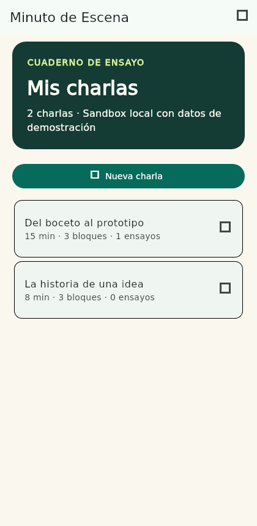
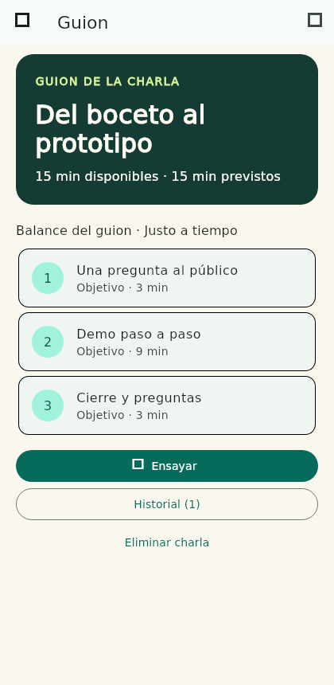

<!-- mobile-factory:hero -->
<div align="center">
<h1>Minuto de Escena</h1>
<p><strong>Ensaya por bloques. Llega al cierre con tiempo.</strong></p>
<p><a href="https://github.com/GianSandoval5/flutter-minuto-de-escena/actions/workflows/ci.yml"></a> <a href="LICENSE"></a> <a href="pubspec.yaml"></a></p>
<p><a href="#el-cuaderno">El cuaderno</a> · <a href="#instalación">Instalación</a> · <a href="#mobilelab-y-sqlite">MobileLab</a> · <a href="#pruebas">Pruebas</a> · <a href="docs/integracion-remota.md">Integración remota</a> · <a href="CONTRIBUTING.md">Contribuir</a></p>
</div>

En una charla de quince minutos, una demo puede comerse el tiempo de las preguntas. Minuto de Escena ayuda a identificar el bloque que necesita un recorte. Diseña un guion, ensáyalo con el móvil y compara los tiempos reales con lo que habías planeado.

[Repositorio público](https://github.com/GianSandoval5/flutter-minuto-de-escena) · [Evidencia de publicación, SDK, pruebas, cobertura y APK](FACTORY_PROVENANCE.json)

## El cuaderno

| Pantalla | Qué puedes hacer |
| --- | --- |
| Mis charlas | Consultar el cuaderno, crear una charla o reintentar la conexión al sandbox. |
| Editor | Asignar de 1 a 180 minutos al evento y a cada bloque. Añadir, ordenar y quitar hasta 20 bloques. |
| Guion | Ver el margen o exceso previsto, editar el plan, ensayar y eliminar una charla con confirmación. |
| Sala de ensayo | Iniciar, pausar, continuar y avanzar al siguiente bloque. Al terminar, revisar y guardar los tiempos. |
| Historial | Comparar el tiempo real con el objetivo original de cada bloque, incluso después de editar el guion. |

El cronómetro mide intervalos con un reloj monotónico. Las pausas quedan fuera del cálculo y cada bloque se redondea al segundo al cerrarlo. La plantilla puede pasarse del presupuesto para que el exceso sea visible. Las pantallas admiten desplazamiento, controles con etiquetas y ancho limitado para tabletas.

<p align="center"> </p>

Capturas del árbol real de widgets Flutter a 420 × 860, con datos sintéticos. La prueba de captura está en [tool/preview](tool/preview/capture_test.dart).

## Instalación

Necesitas Git, Flutter estable 3.50.1 con Dart 3.14, JDK 17, Android SDK y un emulador o dispositivo en modo de desarrollo. Para la verificación del sandbox instala también Python 3. Las dependencias directas incluyen Material UI 1.11.1 y http 1.6.x. Consulta las versiones resueltas en [pubspec.lock](pubspec.lock), el [archivo de SDK](https://docs.flutter.dev/install/archive) y la [guía de Material](https://docs.flutter.dev/release/breaking-changes/material-ui-and-cupertino-ui).

```sh
git clone https://github.com/GianSandoval5/flutter-minuto-de-escena.git
cd flutter-minuto-de-escena
flutter doctor
flutter pub get
```

### Instalar el CLI

Descarga el binario de tu plataforma y el archivo `SHA256SUMS` de [MobileLab 1.1.0](https://github.com/GianSandoval5/MobileLab/releases/tag/v1.1.0). Compara el hash antes de instalar. Ejemplo completo para Linux x86-64, desde una carpeta temporal:

```sh
curl -fLO https://github.com/GianSandoval5/MobileLab/releases/download/v1.1.0/mobilelab-linux-amd64
echo '263305e2a0168d01af3334b5a62029e85bf0b319c20d343b35f4b3573459f953  mobilelab-linux-amd64' | sha256sum -c -
mkdir -p "$HOME/.local/bin"
install -m 755 mobilelab-linux-amd64 "$HOME/.local/bin/mobilelab"
export PATH="$HOME/.local/bin:$PATH"
```

En macOS usa el binario Darwin correspondiente a tu procesador, comprueba `shasum -a 256 NOMBRE_DEL_BINARIO` con la entrada de la release e instálalo en tu PATH como `mobilelab`. En Windows usa `Get-FileHash -Algorithm SHA256` y añade el directorio del ejecutable al PATH.

### Ejecutar la app

En una terminal en la raíz del repositorio ejecuta `mobilelab start` y deja el proceso activo. En otra terminal, desde el mismo proyecto:

```sh
mobilelab db status
flutter devices
flutter run --dart-define=MOBILELAB_URL=http://10.0.2.2:4566
```

| Destino | URL para `MOBILELAB_URL` | Conexión |
| --- | --- | --- |
| Emulador Android estándar | `http://10.0.2.2:4566` | Predeterminada en Android. |
| Simulador iOS | `http://127.0.0.1:4566` | Loopback del Mac. |
| Android conectado por USB | `http://127.0.0.1:4566` | Primero ejecuta `adb reverse tcp:4566 tcp:4566`. |
| Dispositivo en LAN privada | `http://IP_DEL_EQUIPO:4566` | Configura `server.host: 0.0.0.0` en mobilelab.yaml, reinicia el CLI y permite el puerto en tu red de desarrollo. |

## MobileLab y SQLite

[MobileLab](https://github.com/GianSandoval5/MobileLab) es el proceso local que atiende CRUD por HTTP para desarrollo y CI. Basta con instalar el CLI. La [configuración](mobilelab.yaml) usa loopback y desactiva autenticación. La [Data API](mobilelab/data.yaml) declara una colección de documentos. El primer inicio crea la base de negocio `mobilelab/data.db` y carga las [semillas sintéticas](mobilelab/seeds/talks.json). En reinicios se conservan los cambios; MobileLab siembra recursos vacíos. Para inspeccionar los documentos en el equipo anfitrión, ejecuta `curl http://127.0.0.1:4566/api/talks`.

| Operación utilizada | Ruta | Resultado |
| --- | --- | --- |
| GET | /api/talks | Lista los guiones, sus bloques y ensayos. |
| PUT | /api/talks/{id} | Crea o reemplaza el documento con ID estable. |
| DELETE | /api/talks/{id} | Elimina el guion y su historial. |

La app usa HTTP estándar. Las bases de negocio e historial interno, el estado administrativo y las claves se excluyen del control de versiones. Trabaja con datos de demostración. [Documentación primaria de la API](https://github.com/GianSandoval5/MobileLab/blob/master/docs/data-api.md).

## Arquitectura

| Directorio | Responsabilidad |
| --- | --- |
| `lib/features/talks/domain` | Guion, bloque, ensayo inmutable, reglas de duración, reloj y contrato del repositorio. |
| `lib/features/talks/data` | DTO, validación y traducción de errores del adaptador HTTP. |
| `lib/features/talks/presentation` | Estado observable y cinco pantallas. Las escrituras actualizan el cuaderno después de la confirmación del servidor. |
| `lib/main.dart` | Composición del cliente inyectable, URL por plataforma, tema y navegación inicial. |
| `test`, `tool`, `scripts` | Pruebas aisladas, integración con proceso real y capturas reproducibles. |

## Pruebas

```sh
dart format --output=none --set-exit-if-changed lib test tool
flutter analyze
flutter test --coverage
MOBILELAB_BIN=/ruta/absoluta/mobilelab python3 scripts/verify_mobilelab.py
flutter build apk --debug
```

Las pruebas ordinarias sustituyen HTTP o el repositorio para probar fallos, timeout, serialización, reloj, estado y flujos de widgets. La integración usa un puerto disponible y un entorno temporal con copias de las semillas. Guarda un ensayo con el adaptador Dart, detiene y arranca el proceso, comprueba todos los parciales y borra el registro de prueba. En Linux con DejaVu Sans también genera las capturas; puedes indicar otra fuente TTF con `CAPTURE_FONT`. Puedes repetir las verificaciones en [GitHub Actions](.github/workflows/ci.yml). El artefacto Android es un APK debug.

## Alcance y próximos pasos

El cuaderno está diseñado para un operador y requiere acceso al proceso local. Los ensayos en curso viven en memoria hasta guardarlos. El historial forma parte del documento de la charla y está sujeto al límite de 1 MiB de MobileLab. La validación automatizada de plataforma cubre Android. La hoja de ruta contempla recuperar un ensayo interrumpido y comparar tendencias entre varias prácticas. Para un backend multiusuario, sigue la [guía de integración remota](docs/integracion-remota.md). El [registro de ideas y referencias](docs/registro.md) documenta la selección del proyecto.

## Conecta con Gian Sandoval

**Gian Sandoval — Arquitecto Mobile.** Si este cuaderno te ayuda a preparar una charla, ¡deja una ⭐ en GitHub! El código original se distribuye bajo [licencia MIT](LICENSE). Consulta también los [avisos de terceros](THIRD_PARTY_NOTICES.md), el [código de conducta](CODE_OF_CONDUCT.md) y el [canal de seguridad](SECURITY.md).

[GitHub](https://github.com/GianSandoval5) · [LinkedIn](https://www.linkedin.com/in/giansandoval/) · [Web](https://giansandoval.com)
